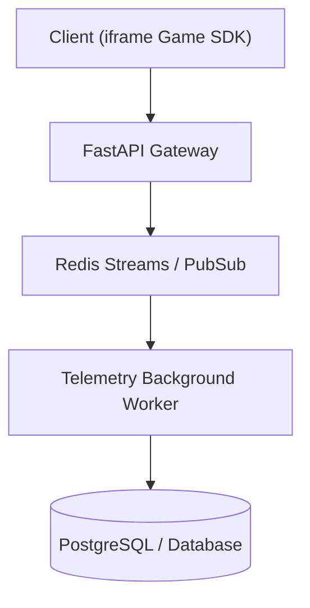

# Pixora - Arcade Gaming Platform

Pixora is a retro-style web arcade platform with 17 mini-games, user accounts, and real-time leaderboards.

---

## Architecture

The following diagram illustrates the decoupled event-driven telemetry and gaming pipeline:



1. **Client (iframe Game SDK)**: WebGL/HTML5 games run inside sandboxed iframes and communicate with Pixora Gateway via postMessage / Pixora Universal Bridge SDK.
2. **FastAPI Gateway**: Handles HTTP routing, WebSocket presence channels, token authentication, and dispatches high-throughput telemetry without locking relational tables.
3. **Redis Streams / PubSub**: Provides ultra-fast sorted sets (`ZSET`) for real-time leaderboards, in-memory presence tracking, and message queues.
4. **Telemetry Background Worker**: Asynchronously consumes batched gameplay events and score updates from Redis queues and flushes them to persistent storage.
5. **Database (PostgreSQL / SQLite)**: Relational persistent store for user accounts, historical game records, and administrative catalog entries.

---

## Security Model

Pixora enforces defense-in-depth principles across authentication, secret management, and anti-cheat validation:

### 1. Authentication Model
- **User Sessions**: Web sessions use signed HTTP-only cookies (`session`) serialized with `itsdangerous.URLSafeTimedSerializer` using SHA-256 HMAC and `SameSite=Lax` protection.
- **API & Game Client Tokens**: Headless and iframe SDK clients authenticate via standard `Bearer` tokens signed with timed cryptographic player claims.
- **Password Security**: All user and admin passwords are encrypted using `bcrypt` salted hashes. Legacy weak hashes and backdoor credentials have been purged.
- **Admin Portal Protection**: Dedicated admin console (`/admin`) requires explicit administrative privilege verification (`is_admin_authenticated` session flag or database `is_admin=True`).
- **Secure Seeding**: First admin accounts are provisioned via CLI seed scripts (`create_admin.py`) reading `ADMIN_USERNAME` and `ADMIN_PASSWORD` from environment variables, refusing passwords shorter than 12 characters.

### 2. Secrets Handling & Hygiene
- **Fail-Fast Startup Validation**: The application performs strict configuration checks on startup (`validate_secrets()`). If required secrets (`SECRET_KEY`, `DATABASE_URL`, or Cloudflare R2 credentials if storage is enabled) are missing or left as default placeholders (e.g. `CHANGE_ME`), the application halts immediately with clear diagnostics.
- **Git Tracking Prevention**: Environment secret files (`.env`, `.env.*`) are ignored in `.gitignore`. Only sanitized templates (`.env.example`) containing placeholder values are maintained.
- **Automated Secret Scanning**: Pre-commit hooks (`.pre-commit-config.yaml`) and GitHub Actions CI (`.github/workflows/ci.yml`) enforce automated Gitleaks scans on every commit and pull request.

### 3. Anti-Cheat Model & Honest Client-Side Limits
- **Server Heuristics**: Game score submissions are guarded by:
  - Cryptographic session tokens (`HMAC-SHA256`) binding `player_id`, `game_slug`, and `start_time_ms`.
  - Replay attack detection consuming tokens after single submission.
  - Score velocity thresholds (`max_rate` points/sec) calibrated per game.
  - Minimum session duration bounding and action-entropy variance validation.
- **Honest Client-Side Limits**: **Client-side games running in a browser environment can never be 100% trusted.** Because HTML5/JavaScript code executes on the client device, an adversary with access to browser DevTools, memory debuggers, or modified runtime engines can tamper with game variables before scores are reported. Pixora's anti-cheat heuristics reject naive tampering, automated bot loops, replay attempts, and impossible score rates, but complete cheat-proofing fundamentally requires server-authoritative game simulation.

---

## Features

- **17 Mini-Games**: Includes classics like 2048, Flappy Bird, Speed Typing, Pong, Memory Match, Whack-a-Mole, Tic-Tac-Toe, and more.
- **User Accounts & Guest Mode**: Players can register an account to save their scores or play immediately as a guest.
- **Live Leaderboards**: Tracks top scores for each game.
- **Real-Time Player Counter**: Uses WebSockets to show how many players are currently in each game.
- **Anti-Cheat Validation**: Checks game duration, score velocity, action entropy, and replay tokens.
- **Admin Dashboard**: Administrative portal to manage player records, upload game bundles, and audit telemetry.

---

## Tech Stack

- **Backend**: Python 3.11+, FastAPI, Uvicorn
- **Database**: PostgreSQL (production) / SQLite (development/testing) with SQLAlchemy ORM
- **Caching & Real-Time**: Redis (Redis Streams, Sorted Sets, Pub/Sub, presence)
- **Frontend**: HTML5, CSS3, JavaScript, Jinja2 templates
- **Testing**: Pytest, Pytest-Cov, Pytest-Asyncio, Ruff

---

## Getting Started

### 1. Prerequisites
- Python 3.11 or higher
- Redis (optional; in-memory queue fallback is automatically active if Redis is offline)

### 2. Setup Virtual Environment
```bash
python3 -m venv .venv
source .venv/bin/activate
```

### 3. Install Dependencies
```bash
pip install -r requirements.txt
```

### 4. Configure Environment
Copy `.env.example` to `.env` and configure your credentials:
```bash
cp .env.example .env
```
*(Make sure to replace all `CHANGE_ME` placeholders with secure values).*

### 5. Run the App
```bash
python app.py
```
Or:
```bash
./run.sh
```

Now open [http://localhost:8000](http://localhost:8000) in your browser.

### 6. Rebuilding Redis Leaderboards (If Needed)
If you change `REDIS_KEY_PREFIX`, flush Redis, or migrate from legacy keys (`glitch4ce:*`), rebuild the Redis leaderboard ZSETs idempotently from the database:
```bash
python -m app.utils.rebuild_leaderboards
# Optional: also purge orphaned legacy glitch4ce:* keys
python -m app.utils.rebuild_leaderboards --purge-legacy
```

---

## Optional: Running with Docker

If you prefer to run everything using Docker:
```bash
docker compose up --build
```
This starts PostgreSQL, Redis, and the Pixora app together.

---

## Running Tests and Linting

To run the automated test suite:
```bash
# Run all tests
pytest

# Run tests with code coverage report
pytest --cov=app --cov-report=term-missing

# Run code style and security linter
ruff check .
```

---

## Project Structure

```
Pixora/
├── app/
│   ├── config.py         # Application settings and startup secrets validation
│   ├── models.py         # Database models (User, Game, GameScore, GameplaySession)
│   ├── database.py       # SQLAlchemy database session & engine
│   ├── templates.py      # Jinja2 template environment & helpers
│   ├── auth_deps.py      # Session cookies, bearer tokens, and auth dependencies
│   ├── routers/          # Route controllers (auth, hub, games, admin, errors)
│   ├── services/         # Anti-cheat validator and score velocity rules
│   └── utils/            # Telemetry queues, R2 storage, seeding utilities
├── public/
│   └── games/            # Standalone game assets and bundles
├── static/               # CSS, JavaScript, and image files
├── templates/            # HTML templates
├── tests/                # Test suite (unit, integration, regression, coverage)
├── gateway.py            # FastAPI ASGI gateway and WebSocket endpoints
├── worker.py             # Background telemetry processor
├── app.py                # Main server entrypoint
└── requirements.txt      # Python dependencies
```

---

## License

MIT License.
