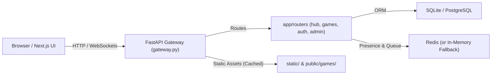

# Pixora Arcade

A retro web arcade platform with 17+ playable mini-games, user accounts, and fast browser gameplay.

## Architecture



## Folder Structure

```text
Pixora/
├── api/            # Vercel serverless entrypoint (index.py)
├── app/            # FastAPI backend (routers, services, models, utils)
├── frontend/       # Next.js frontend
├── migrations/     # Alembic database migrations
├── public/games/   # Standalone mini-game bundles
├── scripts/        # Maintenance & CLI scripts (create_admin, show_database, reset_data, optimize_images)
├── static/         # Shared CSS, JS, images, audio
├── templates/      # Jinja2 HTML templates
├── tests/          # Pytest test suite
├── docs/           # API documentation (docs/API.md)
└── Makefile        # Common dev commands (run, test, lint, format)
```

## Quick Start (Local)

1. **Clone the repo**
   ```bash
   git clone https://github.com/Spidey173/Pixora17.git
   cd Pixora17
   ```
2. **Install dependencies**
   ```bash
   pip install -r requirements.txt
   ```
3. **Configure environment**
   Copy `.env.example` to `.env` and set `SECRET_KEY` (and `DATABASE_URL` / `REDIS_URL` if using external services).
4. **Run the app**
   ```bash
   make run   # or ./run.sh
   ```
   Open `http://127.0.0.1:8000` in your browser.

## Testing & Linting

```bash
make test   # pytest -q
make lint   # ruff check .
```

## Documentation & Live Demo

- **API Docs:** [docs/API.md](docs/API.md)
- **Live Demo:** https://pixora18.vercel.app/
